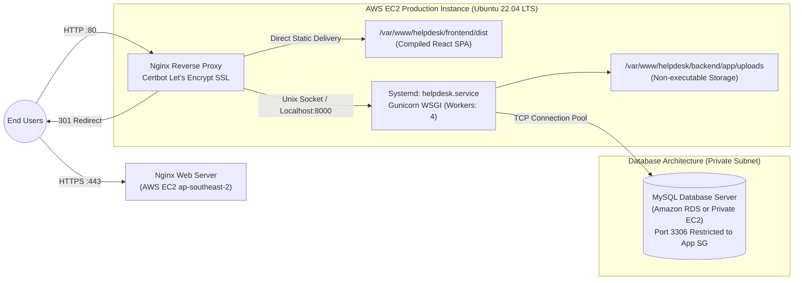

# System Architecture & Technical Topology

The **AI-Powered Customer Support & Helpdesk** is designed as a secure, modular monolithic web application built on modern software engineering paradigms.

## Multi-Tier Architecture Overview

```mermaid
flowchart TD
    Client["React Frontend (SPA)\nVite + Bootstrap 5 + React Router"]
    
    subgraph ReverseProxy["Edge & Web Gateway"]
        Nginx["Nginx Reverse Proxy & Static Server\n(Port 80/443 HTTPS)"]
    end
    
    subgraph WSGI["Application Server"]
        Gunicorn["Gunicorn WSGI Process Manager\n(127.0.0.1:8000)"]
    end
    
    subgraph BackendApp["Flask Backend Architecture"]
        direction TB
        AppInit["Application Factory (create_app)\nCORS, Error Handlers, Rate Limiter"]
        
        subgraph SecurityLayer["Security & RBAC Middleware"]
            JWT["JWT Authentication (PyJWT)"]
            RBAC["Role-Based Permissions (@roles_required)"]
            UploadSec["Magic-Byte File Validator"]
            PromptSec["Prompt Injection & PII Masking"]
        end
        
        subgraph Blueprints["REST API Blueprints (/api/v1)"]
            AuthBP["/auth"]
            UserBP["/users & /admin"]
            TicketBP["/tickets & /messages"]
            AttachBP["/attachments"]
            KBaseBP["/knowledge"]
            AIBP["/ai"]
            AnalyticsBP["/analytics"]
            NotifBP["/notifications"]
        end
        
        subgraph ServiceLayer["Business Logic Layer"]
            TicketSvc["ticket_service.py"]
            ConvoSvc["conversation_service.py"]
            AssignSvc["assignment_service.py"]
            SLASvc["sla_service.py"]
            AuditSvc["audit_service.py"]
            AttachSvc["attachment_service.py"]
        end
        
        subgraph AIService["AI & Search Subsystem"]
            FAQAssistant["faq_assistant.py (Grounded RAG)"]
            Classifier["ticket_classifier.py"]
            Replier["response_generator.py"]
            BM25Search["knowledge_search.py (Local Search)"]
            ExtLLM["ai_config.py (Gemini / OpenAI API)"]
        end
    end
    
    subgraph StorageData["Data & Persistence"]
        MySQL[("MySQL Relational DB\n(InnoDB, utf8mb4)")]
        DiskStorage[("Protected File Storage\n(app/uploads/ - Non-public)")]
    end

    Client -->|HTTPS / JSON REST API| Nginx
    Nginx -->|Static Assets| Client
    Nginx -->|Proxy /api/*| Gunicorn
    Gunicorn --> AppInit
    AppInit --> SecurityLayer
    SecurityLayer --> Blueprints
    Blueprints --> ServiceLayer
    ServiceLayer --> MySQL
    ServiceLayer --> DiskStorage
    ServiceLayer --> AIService
    AIService --> BM25Search
    AIService -.->|External API (Optional)| ExtLLM
```

## Production AWS Deployment Architecture



## Key Architectural Principles

1. **Decoupled Frontend & Backend**: React consumes pure REST endpoints returning structured JSON. No server-side HTML rendering.
2. **Centralized Security Layer**: Magic-byte inspection guarantees uploaded files cannot disguise executable payloads. Token revocation blocklist guarantees deterministic logout.
3. **Resilient AI Subsystem**: The helpdesk never breaks when AI services are offline or API keys are missing. Local BM25 and heuristic models act as seamless fallbacks.
4. **Data Privacy by Design**: Prompt sanitizers redact credit cards, phone numbers, and email addresses prior to routing queries to third-party LLMs.
