# Entity-Relationship (ER) Architecture

The **AI-Powered Customer Support & Helpdesk** database is built on a relational MySQL engine (`customer_support_db`) using `utf8mb4_unicode_ci` collation and `InnoDB` transactions.

```mermaid
erDiagram
    users ||--o{ tickets : "creates (as customer)"
    users ||--o{ tickets : "handles (as agent)"
    users ||--o{ ticket_messages : sends
    users ||--o{ ticket_attachments : uploads
    users ||--o{ ticket_status_history : records
    users ||--o{ notifications : receives
    users ||--o{ saved_replies : owns
    users ||--o{ knowledge_articles : authors
    users ||--o{ audit_logs : triggers

    ticket_categories ||--o{ tickets : categorizes
    knowledge_categories ||--o{ knowledge_articles : organizes

    tickets ||--o{ ticket_messages : contains
    tickets ||--o{ ticket_attachments : attaches
    tickets ||--o{ ticket_status_history : tracks
    tickets ||--o| sla_records : monitors
    tickets ||--o{ notifications : associates

    ticket_messages ||--o{ ticket_attachments : links

    users {
        int user_id PK
        string name
        string email UK
        string password_hash
        enum role "admin, agent, customer"
        enum account_status "active, inactive"
        boolean is_seed
        datetime created_at
        datetime updated_at
    }

    ticket_categories {
        int category_id PK
        string category_name UK
        string description
        boolean is_active
        datetime created_at
        datetime updated_at
    }

    tickets {
        int ticket_id PK
        string ticket_number UK
        int customer_id FK
        int assigned_agent_id FK
        int category_id FK
        string subject
        text description
        enum priority "low, medium, high, critical"
        enum status "open, assigned, in_progress, waiting_for_customer, resolved, closed"
        datetime created_at
        datetime updated_at
        datetime resolved_at
        datetime closed_at
    }

    ticket_messages {
        int message_id PK
        int ticket_id FK
        int sender_id FK
        text message_content
        enum message_type "public, internal"
        datetime created_at
        datetime updated_at
    }

    ticket_attachments {
        int attachment_id PK
        int ticket_id FK
        int message_id FK
        int uploaded_by FK
        string original_filename
        string stored_filename UK
        string file_path
        string mime_type
        int file_size
        boolean is_internal
        datetime uploaded_at
    }

    ticket_status_history {
        int history_id PK
        int ticket_id FK
        int changed_by FK
        string event_type
        string old_status
        string new_status
        string remarks
        datetime changed_at
    }

    knowledge_categories {
        int category_id PK
        string category_name UK
        string description
        datetime created_at
        datetime updated_at
    }

    knowledge_articles {
        int article_id PK
        int category_id FK
        string title
        text content
        enum status "draft, published, archived"
        int created_by FK
        datetime created_at
        datetime updated_at
    }

    notifications {
        int notification_id PK
        int user_id FK
        string title
        string message
        string notification_type
        int related_ticket_id FK
        boolean is_read
        datetime created_at
    }

    saved_replies {
        int reply_id PK
        int created_by FK
        string title
        text reply_content
        datetime created_at
        datetime updated_at
    }

    sla_records {
        int sla_id PK
        int ticket_id FK,UK
        datetime response_due_at
        datetime resolution_due_at
        datetime first_response_at
        datetime resolved_at
        enum sla_status "on_track, at_risk, breached, met"
    }

    audit_logs {
        int log_id PK
        int user_id FK
        string action
        string entity_type
        int entity_id
        string description
        datetime created_at
    }

    token_blocklist {
        int id PK
        string jti UK
        datetime expires_at
    }

    app_settings {
        string key PK
        string value
    }
```

## Relational Integrity & Performance Highlights

1. **Foreign Key Restraints**: All ticket interactions, attachments, and logs strictly enforce relational integrity. Deleting a ticket cascades to messages, status history, and attachments.
2. **Indexing Strategy**: Indexes exist on foreign keys (`customer_id`, `assigned_agent_id`, `category_id`), status flags (`status`, `priority`, `is_read`, `account_status`), search fields (`title`, `subject`, `action`), and lookup columns (`jti`, `email`).
3. **Internal vs Public Segregation**: Messages and attachments carry `message_type` and `is_internal` boolean flags, ensuring queries filter out staff notes before returning customer-facing responses.
